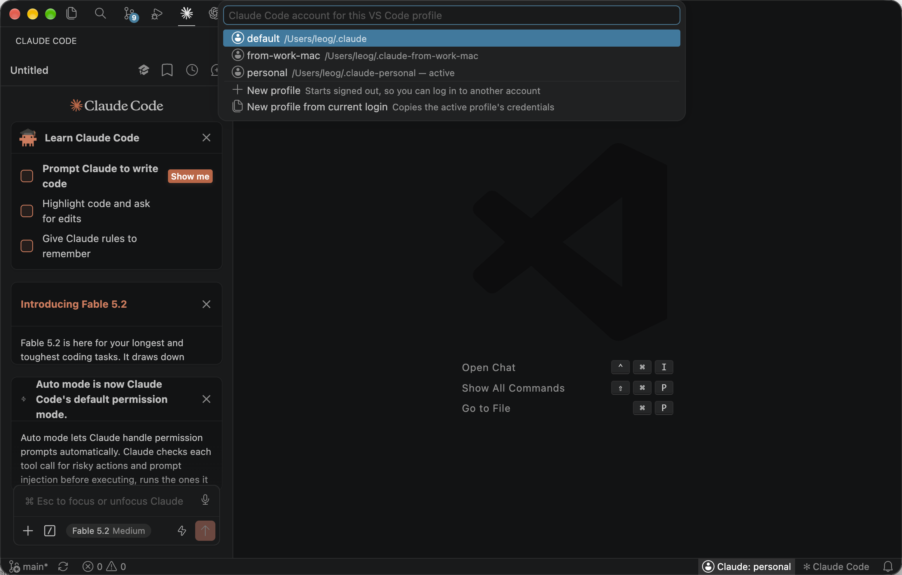
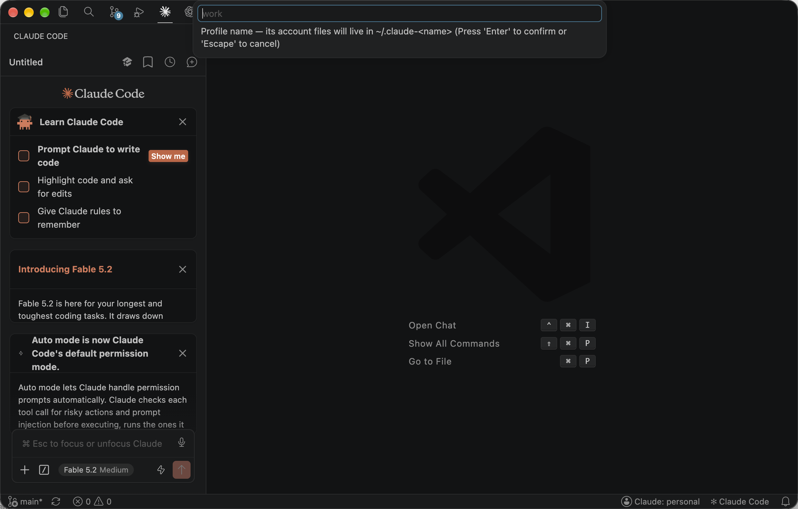

# Claude Code Profiles

Run a different Claude Code account in each VS Code profile, and switch between them from the status bar — no settings editing, no logging out and back in.

Unlike account switchers that swap `~/.claude` credentials behind Claude Code's back, this extension makes `CLAUDE_CONFIG_DIR` actually work inside Anthropic's VS Code extension. Each VS Code profile keeps its own auth, chat history, and sessions — fully isolated, and able to run side by side in separate windows.



## Quick start

1. Install the extension. The patch applies automatically; reload when prompted.
2. Click **Claude: default** in the status bar.
3. Pick **New profile** (starts signed out, log in to another account) or **New profile from current login** (copies your settings, and your login where it's stored on disk), name it, and reload.



That's it — this VS Code profile now has its own Claude Code account. Switch any time from the same status bar item or with `Claude Code Profiles: Switch Profile`. To use two accounts at once, open two windows with different VS Code profiles.

## How it works

Claude Code CLI supports `CLAUDE_CONFIG_DIR`, but Anthropic's VS Code extension only applies `claudeCode.environmentVariables` to the Claude processes it spawns, while its own storage helpers (auth, chat history, sessions) read `process.env.CLAUDE_CONFIG_DIR` directly. So VS Code profile settings alone don't fully isolate accounts — the chat panel still reads the default `~/.claude`.

This extension patches Anthropic's `extension.js` so the configured `CLAUDE_CONFIG_DIR` is visible to the extension process too, and (on builds that still hardcode it) makes the `~/.claude/ide` lock path honor the selected dir. A backup is written next to Anthropic's `extension.js` with the suffix:

```text
.claude-config-dir-patcher.bak
```

The patch re-applies automatically after Claude Code updates. The switcher itself just writes this setting into the current VS Code profile — the same thing you can do by hand:

```json
"claudeCode.environmentVariables": [
  { "name": "CLAUDE_CONFIG_DIR", "value": "/Users/you/.claude-work" }
]
```

## Commands

- `Claude Code Profiles: Switch Profile` — also available by clicking the status bar item
- `Claude Code Profiles: Apply Patch`
- `Claude Code Profiles: Verify Patch`
- `Claude Code Profiles: Restore Backup`

## Error analytics

This extension can send redacted error reports to Sentry when patching, verification, restore, or startup auto-patching fails. It also sends a one-time `extension.installed` event on first activation to estimate install counts, and a `profile.switched` event when the switcher is used — recording only which action ran (switch, create, or capture), never profile names or directory paths. Analytics are sent only when all of these are true:

- VS Code telemetry is enabled.
- `claudeConfigDirPatcher.analytics.enabled` is enabled.

The extension does not send default PII, request data, or file contents. Home directory paths in error messages and stack traces are replaced before sending.

Every report carries an **anonymous user id** so unique users can be counted instead of raw event counts. It is a SHA-256 hash of VS Code's built-in random telemetry id (`vscode.env.machineId`) prefixed with this extension's name. It contains no account, hardware, or personal information, cannot be correlated with any other product's telemetry, and is the only identifier sent — no names, emails, IP addresses, or account ids.

Error reports include the installed Claude Code extension version, redacted target `extension.js` path, backup presence, target source size, a short target source hash, and patch-point status flags so patch failures can be diagnosed without sending the target source file.

The install event includes this extension's installed version and the installed Claude Code extension version when available.

To opt out, disable `claudeConfigDirPatcher.analytics.enabled` or VS Code telemetry (`telemetry.telemetryLevel`); either alone stops all sending. The full field-by-field inventory of what can be sent is in [`telemetry.json`](https://github.com/leog/claude-code-config-dir-patcher-vscode/blob/main/telemetry.json), and all analytics code is open source in [`extension.js`](https://github.com/leog/claude-code-config-dir-patcher-vscode/blob/main/extension.js).

## Local packaging

Install dependencies, then package a VSIX with:

```sh
npm install
```

```sh
npm run package
```

Install the generated VSIX into a specific VS Code profile with:

```sh
code --profile "PROFILE NAME" --install-extension ./claude-code-config-dir-patcher-0.2.0.vsix --force
```

## Caveats

Anthropic extension updates replace `extension.js`, so this helper extension may need to re-apply the patch after updates. If Anthropic changes the minified code shape, the patch will fail rather than editing an unknown location.

**New profile from current login** copies `settings.json` and, when present, `.credentials.json`. On macOS, Claude Code logins usually live in the Keychain and can't be copied — the new profile keeps your settings and asks you to sign in once.

This extension modifies another extension on disk. That is practical for local use, but it may not be accepted by every extension marketplace.
